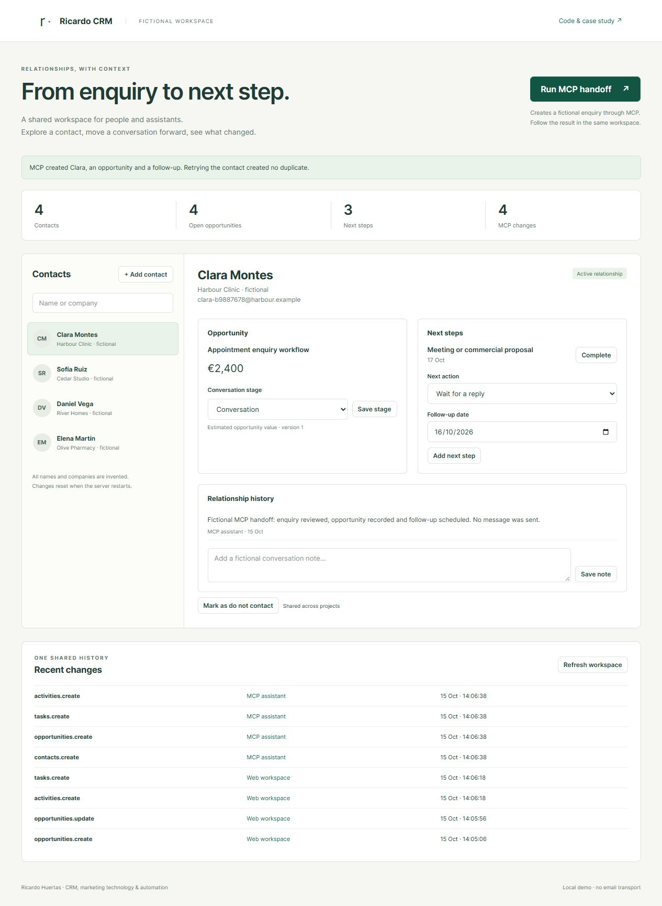
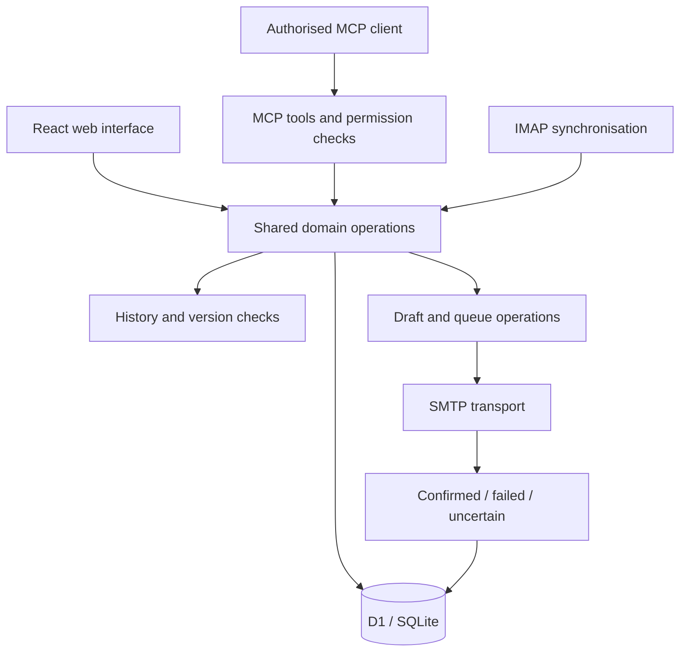

# Ricardo · CRM

I built a private CRM to manage contacts, opportunities, research, campaigns and follow-up across my projects. Its web interface and MCP tools call the same operations against the same database.

**My role:** product design, fullstack development, data model, MCP integration and verification. **Stack:** TypeScript, React, Next.js/Vinext, Cloudflare Workers, D1/SQLite, Drizzle and the MCP SDK. Email integration uses SMTP and IMAP.

## Run the workflow demo

This repository includes an executable demo of contacts, opportunities, follow-up and shared web/MCP operations. Its domain code is extracted from my CRM; the interface and local SQLite adapter are made for this public example.

Requires **Node.js 24+**. From the repository root:

```sh
npm ci
npm start
```

Open **http://127.0.0.1:4318**. Select a contact, update an opportunity or add a next step. **Run MCP handoff** uses a real MCP client to create a fictional enquiry, opportunity, task and history note in the same workspace. It also retries the contact request to demonstrate idempotency.

From a second terminal:

```sh
npm run demo:mcp
npm test
```

The demo uses invented names and `.example` addresses in an in-memory database. Restarting restores the fixtures. [Demo architecture and extraction](demo/README.md).



## The problem

When several projects work with the same contact, separate lists quickly lose context. I wanted one relationship history, with project-specific opportunities and next actions, accessible both by a person in the browser and by an authorised assistant.

That also means an assistant must respect the same permissions, versions, opt-outs and email state as the web interface.

## Architecture



## Engineering decisions

**A shared domain layer.** The browser and MCP are two entry points, not two CRMs. Both use the same validation and persistence rules. Agent permissions do not implicitly grant owner-level access.

**Stable request identifiers and optimistic concurrency.** Retries should reuse an operation identifier. Updates also check the expected version so an assistant cannot silently overwrite a more recent edit.

**Sending is a state machine.** Preparing a draft, authorising it, reserving capacity, attempting SMTP and recording the result are separate transitions. If the transport result is uncertain, the message needs review rather than an automatic retry that could duplicate an email.

**Daily limits follow the business timezone.** Budget windows use Europe/Madrid calendar days. The database reservation counts pending, confirmed and uncertain attempts, and accounts for imported sent messages without counting the same message twice. A check before sending is insufficient if concurrent workers can both spend the last slot; reservation must be enforced in the database operation.

**Responses and opt-outs affect the workflow.** A reply stops the pending sequence. An opt-out applies to the shared contact. Importing history or synchronising a mailbox does not itself send a message.

## Verification and status

The public suite checks the web/MCP workflow, idempotent retries, version conflicts, read-only permissions, shared opt-outs and the local HTTP boundary, alongside seven calendar-window tests. CI runs in three process timezones.

The private project also includes domain and simulated-transport tests for cancellation, follow-up, budgets and delivery events, plus browser and MCP checks.

The application and MCP interface are deployed privately, with manual campaign execution. Native server scheduling is in development. The public demo covers relationship workflows and contains no email transport or production connection.

The isolated [calendar-window example](examples/README.md) checks Madrid daily budget boundaries, including 23-hour and 25-hour days.

For another integration case, see [ConectaYa](https://github.com/ricardohg1998-create/conectaya-case-study).
