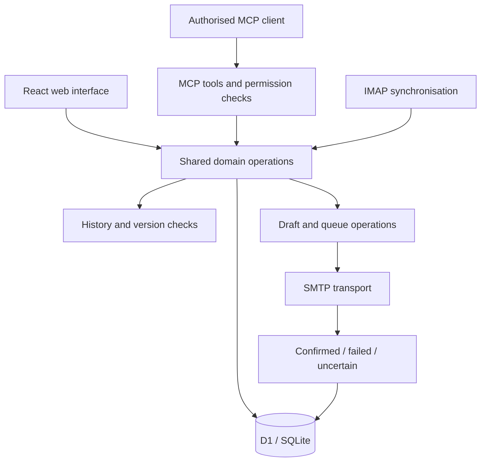

# Ricardo · CRM

I built a private CRM to manage contacts, opportunities, research, campaigns and follow-up across my projects. Its web interface and MCP tools call the same operations against the same database.

**My role:** product design, fullstack development, data model, MCP integration and verification. **Stack:** TypeScript, React, Next.js/Vinext, Cloudflare Workers, D1/SQLite, Drizzle and the MCP SDK. Email integration uses SMTP and IMAP.

## The problem

When several projects work with the same contact, separate lists quickly lose context. I wanted one relationship history, with project-specific opportunities and next actions, accessible both by a person in the browser and by an authorised assistant.

That also means an assistant must respect the same permissions, versions, opt-outs and email state as the web interface.

## Architecture

## Engineering decisions

**A shared domain layer.** The browser and MCP are two entry points, not two CRMs. Both use the same validation and persistence rules. Agent permissions do not implicitly grant owner-level access.

**Stable request identifiers and optimistic concurrency.** Retries should reuse an operation identifier. Updates also check the expected version so an assistant cannot silently overwrite a more recent edit.

**Sending is a state machine.** Preparing a draft, authorising it, reserving capacity, attempting SMTP and recording the result are separate transitions. If the transport result is uncertain, the message needs review rather than an automatic retry that could duplicate an email.

**Daily limits follow the business timezone.** Budget windows use Europe/Madrid calendar days. The database reservation counts pending, confirmed and uncertain attempts, and accounts for imported sent messages without counting the same message twice. A check before sending is insufficient if concurrent workers can both spend the last slot; reservation must be enforced in the database operation.

**Responses and opt-outs affect the workflow.** A reply stops the pending sequence. An opt-out applies to the shared contact. Importing history or synchronising a mailbox does not itself send a message.

## Verification and current boundary

The private project includes domain and simulated-transport tests for permissions, idempotency, cancellation, follow-up, budgets and delivery events, plus browser and MCP checks. Those tests do not prove real-world email delivery.

The app and MCP interface are deployed privately. Manual execution is available; the application's own server timer remains pending as of 13 October 2026. This case does not describe an autonomous scheduled sending system as finished.

## What is public here

This is an architecture and engineering case study. It contains no contact export, mailbox content, database or operational credentials. There is no public login or application installation in this repository.

An isolated [calendar-window example](examples/README.md), adapted from my CRM budget helper, can be run with `npm test` on Node.js 24. It checks the timezone boundary used by daily budgets, including 23-hour and 25-hour days. It does not implement sending, permissions or database reservation.

For another integration case, see [ConectaYa](https://github.com/ricardohg1998-create/conectaya-case-study).
