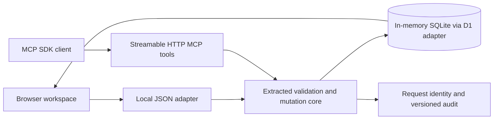

# CRM workflow demo

A local, executable example of the shared domain behind my CRM. The browser and an MCP client create and update the same contacts, opportunities, follow-up tasks and history.

## Try the workflow

1. Run `npm ci` and `npm start` from the repository root, using Node.js 24+.
2. Open `http://127.0.0.1:4318` and select a fictional contact.
3. Change the opportunity stage, add a follow-up and record a fictional note.
4. Click **Run MCP handoff**. A real SDK client calls the local MCP endpoint, creates a contact, retries the same request, and adds an opportunity, task and note.
5. Inspect **Recent changes**: browser and MCP writes appear in one audit history. `npm run demo:mcp` runs the same handoff from another terminal.

All data is held in memory. Restarting the server recreates the fixtures. Use invented details; email addresses must end in `.example`. Phone numbers and websites outside `.example` are rejected.

## Shared domain

| Path | Responsibility |
| --- | --- |
| `core/crm.ts` | CRM validation, links, mutation, version and audit logic |
| `core/next-actions.ts` | Next-action vocabulary, pause and pipeline rules |
| `core/prospect-contract.ts` | Schemas used by the shared domain |
| `schema/` | Table definitions and migrations; no seed records |
| `database.mjs` | SQLite implementation of the D1 methods used by the core |
| `workspace.mjs` | Fictional fixtures, allowed operations and serialised mutation adapter |
| `mcp.mjs` | Eight MCP tools using the same workspace |
| `client.mjs` | MCP handoff and retry demonstration |
| `server.mjs` | Loopback-only HTTP server and static asset allowlist |
| `public/` | Lightweight demo interface |
| `tests/` | Domain and HTTP/MCP integration checks |

Mutations reuse an actor-scoped request ID for retries. Reusing it with a different validated payload produces a conflict. Updates check `expectedVersion`; the single-process adapter serialises mutations so competing edits cannot both commit against one version.

## Extraction

The domain files and SQL migrations were extracted on **15 October 2026**. `core/crm.ts` retains the original prefix through `mutate`, stopping before production authentication and key-management functions. The next-action and prospect contracts and schema migrations are unchanged. File hashes and extraction changes are recorded in [extraction.json](extraction.json).

The SQLite adapter comes from the CRM's test harness. The fixtures, browser interface, HTTP server, bounded MCP catalogue and client walkthrough were built for this demo. The production React application, Cloudflare configuration, mailbox integration, campaign runner, credentials, customer records, logs and databases are excluded.

The local server assigns fixed demonstration actors: browser owner and MCP writer. It has no production authentication and binds only to `127.0.0.1`; keep it local and use synthetic data. No general reuse licence has been selected for the extracted CRM core. The separate calendar example keeps its existing licence.

## Verification

`npm test` exercises a full MCP handoff, shared browser/MCP state, retry collisions, stale and concurrent edits, read-only access, duplicate emails, opt-outs, fictional contact fields and the local HTTP boundary. The root suite also tests Madrid calendar windows across daylight-saving transitions.
